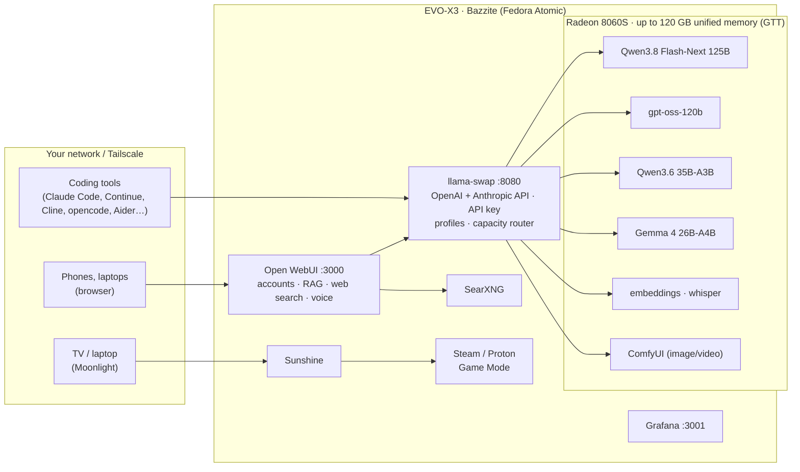

# evo-x3-homelab

Turn a **GMKtec EVO-X3** (AMD Ryzen AI Max+ 395 "Strix Halo", Radeon 8060S, 128 GB LPDDR5X) into:

1. **A 24/7 local AI server** that runs the best open-weight LLMs and serves them to everyone on the LAN (and later, through Tailscale, from anywhere).
2. **A Steam gaming PC** for a desk monitor or a living-room TV.
3. **A machine you can switch between those roles with one command**, and whose GPU/RAM split adjusts itself.

Everything here is scripted, so it can be rebuilt from a blank disk in about an hour, plus model download time.

> Hardware facts, research notes and decisions behind every choice: [`docs/00-hardware.md`](docs/00-hardware.md) and [`docs/01-why-bazzite.md`](docs/01-why-bazzite.md).

---

## What you get



| Piece | What it does |
|---|---|
| **Bazzite** (KDE) | Gaming-focused Fedora Atomic. Updates are atomic, and you can roll back by picking the previous version in the boot menu. Steam Game Mode, Sunshine and Tailscale are built in. |
| **Unified memory via GTT** | The BIOS VRAM is set to 512 MB and the GPU *borrows* up to 120 GB of RAM on demand. No reboot is needed to "re-split" memory: a 95 GB model and a game each take what they need. |
| **llama.cpp in containers** | [kyuz0's Strix Halo images](https://github.com/kyuz0/amd-strix-halo-toolboxes), with Vulkan RADV by default and ROCm 10 per model as an option. |
| **[llama-swap](https://github.com/mostlygeek/llama-swap)** | A single OpenAI- and Anthropic-compatible endpoint for every model. It loads models on demand, keeps as many loaded as fit (capacity router), and switches profiles at runtime. |
| **Open WebUI** | A ChatGPT-style app for the household, with accounts, document chat (RAG), web search (SearXNG), voice in and out, and image understanding. |
| **ComfyUI** | Image and video generation. It frees its memory after 10 idle minutes. |
| **Grafana + Prometheus** | GPU memory, GPU busy, temperatures, power, CPU and network. |
| **restic → Google Drive** | Encrypted nightly backups of configs, chats and Grafana. |
| **`evo` CLI** | `evo mode game\|server\|quiet`, `evo profile smart\|fast\|multi`, `evo status`, `evo doctor`… |

---

## Quick start (fresh machine)

| # | Step | Guide |
|---|---|---|
| 0 | Note the machine's details, reserve an IP on the router, create the Bazzite USB | [02-before-you-wipe](docs/02-before-you-wipe.md) |
| 1 | BIOS: set UMA to minimum, power restore on, performance mode, fan curve | [03-bios](docs/03-bios.md) |
| 2 | Install Bazzite (KDE, AMD) on the 4 TB NVMe | [04-install-bazzite](docs/04-install-bazzite.md) |
| 3 | Clone this repo and run the installer | below and [05-bootstrap](docs/05-bootstrap.md) |
| 4 | Download models, open the chat, connect your tools | [06-llm-server](docs/06-llm-server.md) |
| 5 | Steam, game-mode switching, Sunshine/Moonlight | [07-gaming](docs/07-gaming.md) |
| 6 | Tailscale for access from outside | [08-remote-access](docs/08-remote-access.md) |
| 7 | Dashboards and backups | [09-monitoring-and-backups](docs/09-monitoring-and-backups.md) |
| – | Updates, rollback, troubleshooting, rebuild | [10-operations](docs/10-operations.md) |

```bash
# on the freshly installed Bazzite, in a terminal (Konsole)
git clone https://github.com/MutterPedro/evo-x3-homelab.git ~/evo-x3-homelab
cd ~/evo-x3-homelab
./install.sh system      # kernel args, groups, no-sleep, firewall, SSH, Tailscale (asks for sudo)
systemctl reboot
cd ~/evo-x3-homelab
./install.sh user        # llama-swap, Open WebUI, SearXNG, Grafana, evo CLI
./install.sh models      # ~200 GB of models; leave it running
evo doctor               # everything green?
```

## Everyday use

```bash
evo status                 # what's loaded, GPU memory, temps, power mode
evo mode game              # unload models + max power (then play)
evo mode server            # back to serving (balanced power, preloads the chat model)
evo mode quiet             # low power at night; models load on demand
evo profile smart          # chat/code/vision -> Qwen3.8 Flash-Next (best quality)
evo profile fast           # chat -> gpt-oss-120b, code -> Qwen3.6, vision -> Gemma 4
evo profile multi          # small models only, leaves room for ComfyUI
evo bench chat             # tokens/s of whatever "chat" points to
evo secret api-key         # key for coding tools
evo logs                   # follow llama-swap logs
evo update                 # pull repo + images, re-render configs
```

**Automatic switching for games:** in Steam, set the game's *Launch Options* to `evo run -- %command%`. The models unload when the game starts and come back when it exits.

The app menu also has **EVO: Game mode / Server mode / Quiet mode** launchers.

| URL (use the IP if `evo-x3.local` does not resolve on a device) | |
|---|---|
| `http://evo-x3.local:3000` | Open WebUI (the first account created becomes admin) |
| `http://evo-x3.local:8080/v1` | OpenAI-compatible API (Bearer = `evo secret api-key`) |
| `http://evo-x3.local:8080/ui` | llama-swap: loaded models, live logs, tokens/s, playground |
| `http://evo-x3.local:8080/comfyui/` | ComfyUI |
| `http://evo-x3.local:3001` | Grafana (`admin` / `evo secret grafana`) |
| `https://evo-x3.local:9090` | Cockpit (optional: `ujust cockpit enable`) |

## Repository layout

```
install.sh                    one installer: system | user | models
bin/evo                       day-to-day CLI
config/evo.env.example        all tunables (GTT size, ports, images, profile, backup target)
config/llama-swap/            model definitions, profiles, capacity router
config/models.tsv             which Hugging Face files each model needs
config/open-webui.env         Open WebUI wiring (models, RAG, search, voice)
quadlets/                     rootless podman services (Open WebUI, SearXNG, Grafana…)
systemd/user/                 llama-swap service, nightly backup timer
system/                       files installed under /etc (Wi-Fi, watchdog)
desktop/                      app-menu launchers for the three modes
docs/                         the full guide
tests/render-test.sh          CI: renders all templates and boots llama-swap with them
```

Secrets (API key, Open WebUI secret, Grafana and restic passwords) are generated on the machine into `~/.config/evo/secrets.env` and are **never** committed.

## License

MIT. This repo builds on the work of [kyuz0](https://github.com/kyuz0) (Strix Halo toolboxes), [llama-swap](https://github.com/mostlygeek/llama-swap), [Bazzite / Universal Blue](https://bazzite.gg), [Open WebUI](https://openwebui.com), [Unsloth](https://huggingface.co/unsloth) (GGUF quants) and the Strix Halo Home Lab community.
